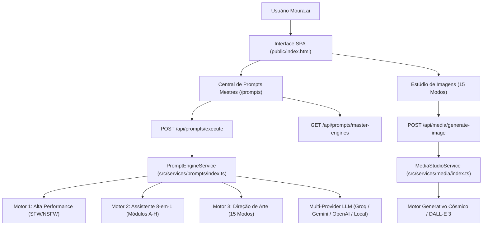

# PLANO DE IMPLEMENTAÇÃO — INTEGRAÇÃO DOS 3 PROMPTS MESTRES NA MOURA.AI
## Implementação dos Motores Avançados de IA no Core Engine, API e Interface

> **Documento Arquitetural e Funcional**  
> **Status:** Concluído com Sucesso e Aprovado nos Testes Automatizados (59/59)  
> **Marca / Plataforma:** **Moura.ai** (Mouras-World)  
> **Repositório GitHub:** `gabrielmoura735/Moura.ai`

---

## 1. Visão Geral e Objetivos

O usuário solicitou a integração oficial de três grandes **Prompts Mestres** de engenharia avançada no ecossistema da Moura.ai:

1. **PROMPT MESTRE ÚNICO — IA de Alta Performance (Texto + Prompt + Imagem SFW/NSFW)**:
   - Motor unificado de máxima competência, direto, sem censuras artificiais quando solicitado.
   - Criação de textos de impacto e prompts fotográficos/artísticos com anatomia, iluminação, composição e atmosfera.
   - Sensibilidade à classificação de conteúdo do perfil (SFW elegante vs. NSFW anatômico/explícito responsável sem rodeios).

2. **PROMPT-MESTRE: ASSISTENTE CRIATIVO E TÉCNICO COMPLETO (8 Módulos A a H)**:
   - Atuação profissional sênior multidisciplinar com regras de rigor técnico e objetividade em PT-BR.
   - **Módulo A:** Geração de Texto (artigos, legendas, e-mails, roteiros com gancho inicial forte).
   - **Módulo B:** Geração de Imagem (prompt em inglês + português + negativo + proporção + 3 variações).
   - **Módulo C:** Geração de Vídeo (conceito, roteiro minutado, storyboard em texto, falas, SFX, prompts de IA cena a cena).
   - **Módulo D:** Áudio, Voz e Música (letras originais, prompts com BPM/instrumentos, direção de voz).
   - **Módulo E:** Código e Automação (código testável, arquitetura, depuração explicada).
   - **Módulo F:** Análise, Pesquisa e Estratégia (SWOT, personas, funis, planos de negócio, SEO).
   - **Módulo G:** Estudo e Ensino (explicação em 4 níveis: criança a avançado, mapas mentais, quizzes).
   - **Módulo H:** Vida Prática e Produtividade (rotinas, viagens, finanças informativas).

3. **MOURA.AI — MOTOR AVANÇADO DE GERAÇÃO DE IMAGENS (15 Modos de Criação & Direção de Arte)**:
   - Motor especialista em direção de arte, fotografia e design visual com checklist de 8 etapas de qualidade.
   - **15 Modos de Criação nativos:**
     1. Fotografia realista
     2. Arte cinematográfica
     3. Anime e mangá
     4. Ilustração digital
     5. Design 3D
     6. Logotipos e identidade visual
     7. Publicidade e marketing
     8. Imagens de produtos
     9. Paisagens e arquitetura
     10. Personagens e criaturas
     11. Interfaces e conceitos visuais de aplicativos (UI/UX)
     12. Infográficos e diagramas
     13. Capas, pôsteres e thumbnails
     14. Imagens para redes sociais
     15. Arte conceitual e mundos de ficção

---

## 2. Arquitetura Técnica Proposta

---

## 3. Plano Detalhado de Implementação

### 3.1. Novo Serviço Backend: `src/services/prompts/index.ts`
- Implementar a classe `PromptEngineService` contendo as 3 definições mestres:
  - `MASTER_ENGINES.high_performance_omni`: Contém as diretrizes exatas do prompt de alta performance, com injeção da classificação etária do usuário (`10`, `12`, `14`, `16`, `18`, `sem_filtro`).
  - `MASTER_ENGINES.creative_technical_assistant`: Contém o prompt do assistente completo, estruturado com os 8 submódulos selecionáveis (A a H), checklist de controle de qualidade e formato de resposta com 4 blocos.
  - `MASTER_ENGINES.advanced_image_engine`: Contém as diretrizes de direção de arte, checklist de 8 etapas de consistência visual e a lista tipada dos 15 modos de criação.
- Métodos auxiliares:
  - `listEngines()`: Retorna os motores com metadados e submódulos para exibição no frontend.
  - `buildPrompt(engineId, userPrompt, options)`: Monta o prompt de sistema enriquecido.
  - `executeEngine(engineId, userPrompt, options, userProfile)`: Executa na cascata LLM da Moura.ai e retorna o resultado estruturado.

### 3.2. Integração no `src/services/media/index.ts`
- Expandir `GenerateImageRequest` para aceitar `creationMode` (1 a 15) correspondente aos 15 modos do Motor Avançado de Imagens.
- Atualizar a geração visual para refletir o modo escolhido (ex: fotografia realista, anime, 3D render, logotipos, interfaces UI, concept art).

### 3.3. Endpoints REST em `src/routes/api.ts`
- `GET /api/prompts/master-engines`: Retorna os prompts mestres, módulos (A-H) e modos (1-15).
- `POST /api/prompts/execute`: Rota autenticada que recebe `{ engineId, prompt, module, mode }` e executa a geração via LLM com os parâmetros do usuário.

### 3.4. Frontend SPA em `public/index.html`
- Adicionar item de navegação **"Prompts Mestres"** na sidebar (ícone `fa-microchip`).
- Criar a view `#view-prompts-master`:
  - 3 Cards principais dos Motores com tabs de alternância rápida.
  - **Motor 1:** Seletor de foco (Texto, Prompt de Imagem, Ambos), botão "Copiar Prompt Mestre" e campo de execução rápida.
  - **Motor 2:** Seletor visual dos 8 Módulos (A a H) com descrição de cada um e botão para testar com a IA.
  - **Motor 3:** Grid interativo com os **15 Modos de Criação**, botão para copiar o sistema de direção de arte e botão "Abrir no Gerador de Imagens".
- No **Estúdio de Imagens por IA (Estilo GPT)**:
  - Adicionar o seletor completo dos **15 Modos de Criação** do Motor Avançado.

### 3.5. Testes Automatizados (`tests/runner.ts`)
- Adicionar **Teste 14**: Integridade dos 3 Prompts Mestres (verificar presença de todos os textos, módulos A a H e modos 1 a 15).
- Adicionar **Teste 15**: Execução do motor de prompts com controle de perfil e classificação indicativa.
- Adicionar **Teste 16**: Compatibilidade do gerador de imagens com os 15 modos de criação.
- Meta: 49+ testes passando com 100% de sucesso.

### 3.6. Compilação, Auditoria e GitHub Push
- Compilar com `npm run build`.
- Executar bateria com `npm test`.
- Reiniciar o servidor daemon na porta `3333`.
- Commit e push para `gabrielmoura735/Moura.ai`.
- Monitorar a pipeline do GitHub Actions para garantir CI verde.

---

## 4. Solicitação de Confirmação

Conforme as diretrizes do **Planning Mode**, nenhuma linha de código foi alterada até este momento.

**Você aprova a execução deste plano de implementação para os 3 Prompts Mestres?**
